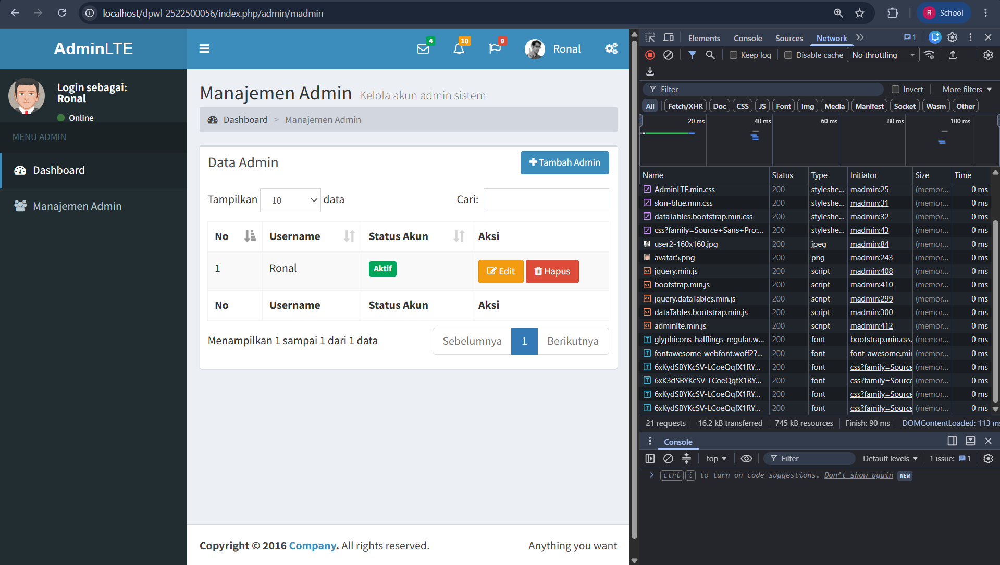

# pertemuan-04
### Verifikasi Baseline P3
#### Kondisi Komponen P3

| Komponen | Kondisi Aktual | Keterangan |
| ---------------------------------- | ------------------------------- | ----------- |
| `application/config/config.php` | `[ada]` | `[catatan]` |
| `application/config/routes.php` | `[ada]` | `[catatan]` |
| `application/controllers/Home.php` | `[ada]` | `[catatan]` |
| `index.php` | `[ada]` | `[catatan]` |

#### Pengujian Route P3 Sebelum Perubahan P4
| Item | Hasil Aktual |
| ---------------- | --------------------------- |
| Route yang diuji | `[berhasil]` |
| Controller | `[berhasil]` |
| Method | `[berhasil]` |
| Hasil akses | `[berhasil]` |
| Status | `[BERHASIL]` |
| Catatan | `[jika ada]` |

#### Kesimpulan
Baseline P2 dinyatakan `[SIAP/TIDAK SIAP]` untuk dikembangkan pada P3.
Catatan: seluruh isi bagian ini harus berdasarkan pemeriksaan dan pengujian
yang benar-benar dilakukan mahasiswa pada workspace P3. Jangan mengisi
hasil berdasarkan contoh, asumsi, atau hasil pengujian yang belum dilakukan.

